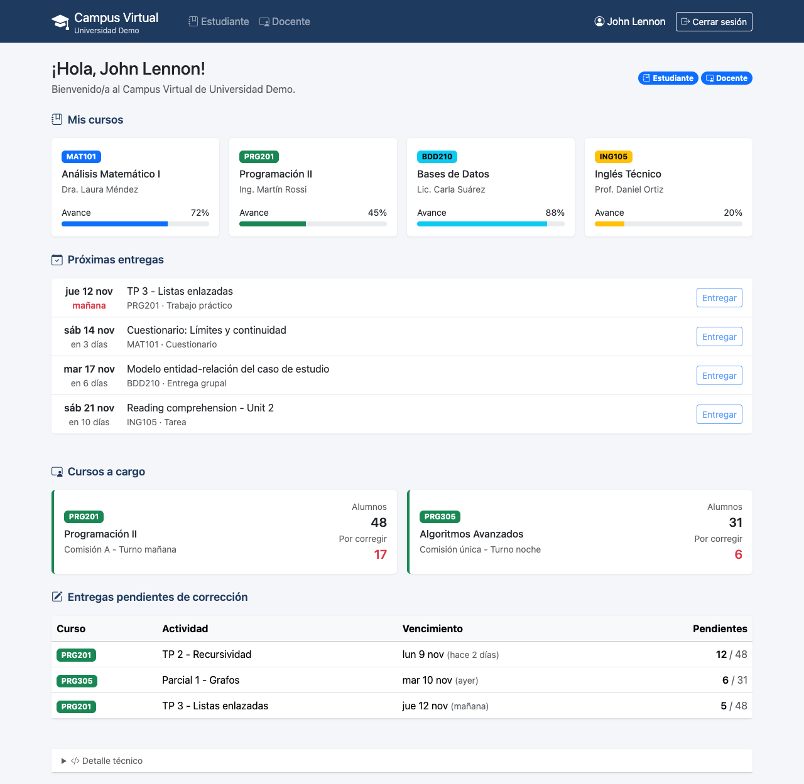

# sherpa-lms

Mock LMS ("Campus Virtual - Universidad Demo") for [Identicum Sherpa](https://identicum.com/iga/) demos.

## What it is

`sherpa-lms` is a small Flask application that simulates a university's **Learning Management System**, for Sherpa-IAM demos in education (sherpa-edu). It has no database and no login of its own: it runs behind [IPAx](https://github.com/Identicum/ipax), which authenticates the user against the IdP and passes the username and roles to the app in HTTP headers.

What the user sees depends only on their `LMS_*` roles. That makes it easy to demo access requests: a user starts with no access, requests a role in the self-service portal, and after a new login sees more of the LMS.

Like [sherpa-hr](https://github.com/Identicum/sherpa-hr), it is a **satellite component** of Sherpa for demos, PoCs and internal tests. It is not deployed at customers as-is. All the data is static mock data; due dates are relative to today, so the demo never looks stale.

It is shipped as a container image:

```sh
docker pull ghcr.io/identicum/sherpa-lms:latest
```



## Roles

| Role          | Label         | Dashboard section                                                         |
|---------------|---------------|---------------------------------------------------------------------------|
| `LMS_STUDENT` | Estudiante    | **Mis cursos** (4 courses with progress) and **Próximas entregas**        |
| `LMS_TEACHER` | Docente       | **Cursos a cargo** (students, submissions to grade) and **Entregas pendientes de corrección** |
| `LMS_ADMIN`   | Administrador | **Administración del campus**: campus KPIs, admin actions, recent activity |

Sections add up: a user with `LMS_STUDENT|LMS_TEACHER` sees both. The nav bar and the role badges next to the greeting also show only the granted roles. Role names are case-sensitive; other roles in the header are ignored.

| Request                                    | Result                                                                                         |
|--------------------------------------------|------------------------------------------------------------------------------------------------|
| No `IPAx-USERNAME` header                  | HTTP 401, "No se pudo identificar al usuario" (the app was reached without IPAx)                |
| Username, but none of the `LMS_*` roles    | HTTP 403, "No tenés acceso al LMS. Solicitalo en el portal de autoservicio", with buttons to the self-service portal (if `SELFSERVICE_URL` is set) and to log out |
| Username and at least one `LMS_*` role     | HTTP 200, dashboard                                                                            |

Every page has a **Cerrar sesión** button that goes to `LOGOUT_URL` (IPAx's `/private/logout` by default) and, at the bottom, a collapsible **Detalle técnico** panel. The panel shows the `IPAx-*` headers the app received (plus `Host` and `X-Forwarded-*`), and which section each `LMS_*` role unlocks. It is meant for technical audiences; hide it with `SHOW_TECH_DETAILS=false`.

## Headers

| Header          | Required | Description                                                       |
|-----------------|----------|-------------------------------------------------------------------|
| `IPAx-USERNAME` | yes      | Username                                                          |
| `IPAx-ROLES`    | no       | Roles, separated by `\|`                                          |
| `IPAx-NAME`     | no       | Display name for the greeting. Falls back to the username         |
| `IPAx-EMAIL`    | no       | Shown in the "Detalle técnico" panel only                         |

The header names and the separator can be changed with environment variables (see below).

## Configuration

| Variable            | Default            | Description                                                        |
|---------------------|--------------------|--------------------------------------------------------------------|
| `LOG_LEVEL`         | `INFO`             | `DEBUG` logs the LMS roles of each dashboard request              |
| `LOGOUT_URL`        | `/private/logout`  | Target of the "Cerrar sesión" button. IPAx's logout path           |
| `SELFSERVICE_URL`   | (empty)            | URL of the self-service portal, linked from the access denied page. Empty: no button |
| `CAMPUS_NAME`       | `Campus Virtual`   | Branding                                                           |
| `INSTITUTION_NAME`  | `Universidad Demo` | Branding                                                           |
| `SHOW_TECH_DETAILS` | `true`             | Show the "Detalle técnico" panel                                   |
| `HEADER_USERNAME`   | `IPAx-USERNAME`    | Header with the username                                           |
| `HEADER_ROLES`      | `IPAx-ROLES`       | Header with the roles                                              |
| `HEADER_NAME`       | `IPAx-NAME`        | Header with the display name                                       |
| `HEADER_EMAIL`      | `IPAx-EMAIL`       | Header with the email                                              |
| `ROLES_SEPARATOR`   | `\|`               | Separator of the roles header                                      |

`GET /health` returns `OK` (container health check).

## Behind IPAx

In IPAx `proxy` mode, add a proxy that passes the user to the app. The claim that carries the roles depends on the IdP; in this example a Keycloak mapper puts the client roles in a multivalued `lms_roles` claim:

```nginx
server {
	server_name lms.example.com;
	include /var/ipax/conf/location_norobots.conf;

	location / {
		access_by_lua_block {
			local ipax = require "ipax"
			local oidc_opts = ipax.get_oidc_opts()
			local session_opts = ipax.get_session_opts()
			ngx.ctx.res = ipax.get_res(oidc_opts, session_opts)
			-- don't send the IPAx session cookies to the app (prevents HTTP error 413)
			ipax.filter_session_cookies(session_opts)
			local user = ipax.get_user(ngx.ctx.res)
			ngx.req.set_header("IPAx-USERNAME", user.preferred_username)
			ngx.req.set_header("IPAx-NAME", user.name)
			ngx.req.set_header("IPAx-EMAIL", user.email)
			ngx.req.set_header("IPAx-ROLES", table.concat(user.lms_roles or {}, "|"))
		}
		proxy_pass http://lms:5000/;
		proxy_set_header Host $host;
		proxy_set_header X-Forwarded-Proto $scheme;
		proxy_set_header X-Forwarded-For $proxy_add_x_forwarded_for;
	}
}
```

Do not use IPAx to deny users without `LMS_*` roles (e.g. with `check_multivalued_user_claim`): the app's own access denied page, with the link to the self-service portal, is part of the demo.

IPAx reads the roles at login, so a role granted later shows up only after the user logs out and logs in again. The access denied page says so.

## Demo flow

1. The user logs in to the LMS. They have no `LMS_*` role yet: **No tenés acceso al LMS**.
2. They follow the link to the self-service portal and request `LMS_STUDENT`. The request is approved and provisioned.
3. They log out and log in again: the dashboard shows **Mis cursos** and **Próximas entregas**.
4. They get `LMS_TEACHER` (or `LMS_ADMIN`) as well: after a new login, the **Docente** (or **Administrador**) section appears below.

Open **Detalle técnico** at each step to show the `IPAx-ROLES` header changing.

## Local development

[compose.yaml](compose.yaml) runs the app, built from the local source with [app/](app/) mounted, behind an nginx that stands in for IPAx: no OIDC, it just injects fixed headers ([localhost/proxy/default.conf.template](localhost/proxy/default.conf.template)).

```sh
docker compose up -d --build
```

- http://localhost: through the fake IPAx, as `jlennon` with `LMS_STUDENT|SOME_OTHER_ROLE`.
- http://localhost:8000: the app directly, without headers (HTTP 401).

To try other roles, recreate the proxy with `LOCAL_ROLES`:

```sh
LOCAL_ROLES="SOME_OTHER_ROLE" docker compose up -d proxy                     # access denied
LOCAL_ROLES="LMS_STUDENT|LMS_TEACHER|LMS_ADMIN" docker compose up -d proxy   # every section
```

After changing files in [app/](app/), run `docker compose restart lms`.

## Application structure

- [app/main.py](app/main.py): reads the headers, decides 401 / 403 / dashboard, and holds the role → section map.
- [app/data.py](app/data.py): static mock data (courses, deliverables, grading, admin KPIs).
- [app/templates/](app/templates/): Bootstrap 5 server-rendered pages: `dashboard.html`, `denied.html`, `unauthenticated.html`, and `tech_details.html` (the collapsible panel).

The image is built on `ghcr.io/identicum/python-flask` and pushed to `ghcr.io/identicum/sherpa-lms` (`latest` and a `YYYYMMDD` tag) by [.github/workflows/docker-build.yml](.github/workflows/docker-build.yml) on every push to `main` that changes `app/` or the `Dockerfile`.
